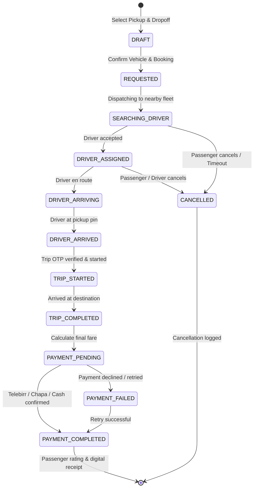

# Kings Taxi — System Architecture & Design Specification

## 1. Architectural Philosophy

Kings Taxi Passenger Mobile Application is constructed according to **Clean Architecture** principles adapted for modern React Native with Expo:

1. **Separation of Concerns**: UI components remain decoupled from business logic and data transport layers.
2. **Feature-First Modularity**: High cohesion within business capabilities (`rides`, `hotels`, `heritage`, `payments`, `auth`), minimizing cross-boundary side effects.
3. **Uni-directional Data Flow**: UI dispatches intent -> Services/Stores mutate state -> Reactive UI re-renders predictably.
4. **Resilience & Graceful Degradation**: Offline resilience, network retry policies, and fallback flows (e.g., manual map pin drop when GPS is disabled).

---

## 2. High-Level System Architecture Diagram

```mermaid
flowchart TD
    subgraph UI_Layer ["Presentation Layer (Expo Router + UI Primitives)"]
        Nav["Expo Router Root Layout"]
        Tabs["(tabs) Bottom Navigation"]
        AuthFlow["(auth) Authentication Flow"]
        ModalFlow["Modal Screens (Booking, Payments, Filters)"]
        UIComponents["Reusable UI Components (Buttons, Cards, Inputs, Badges)"]
    end

    subgraph Feature_Layer ["Feature Modules (Domain UI + Controllers)"]
        FAuth["Authentication & OTP"]
        FRides["Ride-Hailing & Realtime Tracking"]
        FHotels["Hotel Discovery & Reservations"]
        FTours["Heritage & Full-Contract Transportation"]
        FPay["Multi-Gateway Payment Hub"]
        FProfile["Passenger Profile & Preferences"]
    end

    subgraph State_Layer ["State Management & Caching"]
        AuthStore["Auth Zustand Store (Tokens, User Profile)"]
        RideStore["Ride Zustand Store (Active Trip, Coordinates, Category)"]
        QueryClient["TanStack Query (Hotels, Heritage, Bookings Cache)"]
    end

    subgraph Service_Layer ["Data Access & External Services"]
        HttpAdapter["Axios HTTP Client (Interceptors, Token Refresh)"]
        MockServices["Mock Service Layer (Realistic Delay & Data)"]
        LocationAdapter["Expo Location Service (Perms, Geocoding)"]
        StorageAdapter["SecureStore Adapter (Biometrics/Secure Token)"]
        RealtimeAdapter["Socket.IO Client (Driver Location & Trip State)"]
    end

    subgraph Backend_Target ["Centralized Kings Taxi Backend (Future)"]
        REST_API["Kings Taxi REST API Gateway"]
        WS_GATEWAY["WebSocket Realtime Cluster"]
        PAY_GATEWAYS["Payment Partners (Chapa, Telebirr, CBE Birr)"]
    end

    UI_Layer --> Feature_Layer
    Feature_Layer --> State_Layer
    Feature_Layer --> Service_Layer
    State_Layer --> Service_Layer
    Service_Layer -.-> Backend_Target
```

---

## 3. Core Architectural Modules

### 3.1 Presentation Layer (`apps/passenger-mobile/app` & `src/components`)
- **Route Navigation**: Thin router endpoints inside `app/` that import encapsulated feature components from `src/features/`.
- **Atomic UI Primitives**: Standardized building blocks (`PrimaryButton`, `FormInput`, `StatusBadge`, `DestinationCard`) governed by design tokens.

### 3.2 State Management Layer (`src/stores`)
- **Auth Store**: Manages passenger session, authorization state, refresh lifecycle, and persists security tokens to `Expo SecureStore`.
- **Ride Store**: Tracks active ride lifecycle (`REQUESTED` -> `SEARCHING_DRIVER` -> `DRIVER_ASSIGNED` -> `TRIP_STARTED` -> `COMPLETED`), selected pickup/destination coordinates, vehicle category, and driver telematics.
- **Server Cache (`TanStack Query`)**: Manages caching, invalidation, and background synchronization for hotels, tours, notifications, and booking history.

### 3.3 Data & Service Abstraction Layer (`src/services`)
- Every domain service exports a standardized interface (e.g. `IRideService`, `IHotelService`, `IPaymentService`).
- In offline/development mode, services execute against comprehensive in-memory mock adapters with deterministic latency, simulating network conditions and real-world edge cases.
- In production, adapters target the remote REST/WebSocket gateway via `src/services/api/httpClient.ts`.

---

## 4. Ride Lifecycle State Machine

---

## 5. Security & Reliability Tenets

1. **Token Storage**: JWT tokens stored only via `expo-secure-store`, never in plaintext `AsyncStorage`.
2. **Idempotent Transactions**: All payment requests send a unique client-generated UUID `idempotency-key` to eliminate duplicate charges.
3. **Location Privacy**: Location permissions requested in-context with educational rationale; app supports full booking capabilities through manual pin placement and address search if permissions are withheld.
4. **Strict Typing**: No unchecked `any` allowed in codebase; comprehensive schemas with Zod ensure runtime validation of external payloads.
